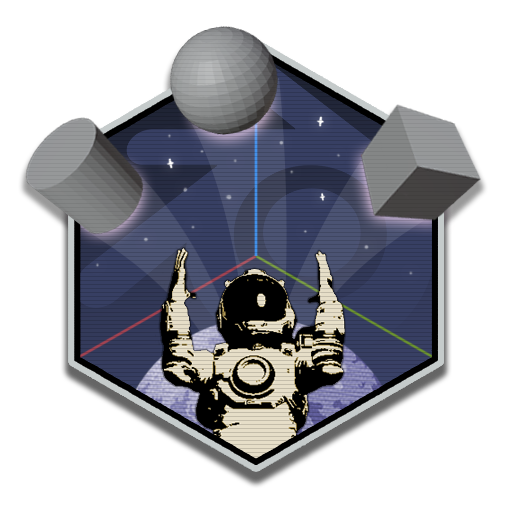
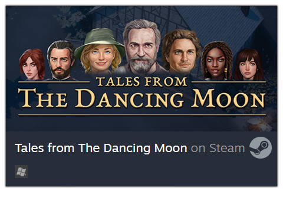

# No Mans Sky Base Builder

  
   
A plugin for Blender to build bases in No Mans Sky. 
Community Discord: <a href="https://discord.gg/kpGVRKPn5W">https://discord.gg/kpGVRKPn5W</a>

  <a href="#key-features">Key Features</a> •
  <a href="#requirements">Requirements</a> •
  <a href="#how-to-use">Guides</a> •
  <a href="#credits">Credits & Support</a> •
  <a href="#screenshots">Screenshots</a> •

## Key Features

* Build bases for No Mans Sky using proxy representations for building parts.
* Translate, rotate and scale any base part to any position and any size!
* Define presets to build complex items quickly. Share or download presets online.
* Save and Load bases to disk (.json format).
* Import and Export back and forth from the game using the No Mans Sky Save Editor.
* Snapping features help with the placement of base parts. Similar to the snapping features in-game.
* A Power and Logic UI panel helps manage electricity and switches.
* An asset browser for searching and locating base parts.

## Requirements

* Blender
    * https://www.blender.org
* Latest Base Builder Release
    * https://github.com/djmonkeyuk/nms-base-builder/releases
* A No Mans Sky Save Editor, you have a few options:
    * GoatFungus - https://github.com/goatfungus/NMSSaveEditor
    * NomNom - https://github.com/zencq/NomNom 
    * NMSBaseJsonEditor - https://www.nexusmods.com/nomanssky/mods/3849

 

## Official Guides

For the latest and greatest guidance on installation and how to use this Blender extension, please visit the <a href="https://djmonkey.uk/no-mans-sky-base-builder-blender/guides/" target="_blank">official guide pages.</a>

## Preset Location

Presets are stored in your "**%USERPROFILE%\NoMansSkyBaseBuilder\presets**" directory.
These can be downloaded and shared with other people.

Visit the <a href="https://discord.gg/kpGVRKPn5W" target="_blank">Community Discord</a> where creators share their own prefabs!

## Credits & Support

Created and maintained by DjMonkey. You can reach out via various social media channels:

* Discord: <a href="https://discord.gg/kpGVRKPn5W">https://discord.gg/kpGVRKPn5W</a>
* Threads: <a href="https://www.threads.net/@djmonkeyuk" target="_blank">@djmonkeyuk</a>
* Twitter/X: <a href="https://www.x.com/djmonkeyuk" target="_blank">@djmonkeyuk</a>
* BlueSky: <a href="https://bsky.app/profile/djmonkeyuk.bsky.social" target="_blank">@djmonkeyuk.bsky.social</a>

## Play my Indie Game!

If you have enjoyed using my tools, consider playing my very own indie game! It is the best way you can support me!

> <i>'Tales from the Dancing Moon' is a life-sim RPG set in a parallel universe inspired by UK culture and fantasy novels. After the events of a shadow-beast invasion on a seaside town, complete villager quests and collect hidden diaries to understand your role in this mysterious character-driven story.</i>

There is a <a href="https://store.steampowered.com/app/1782420/Tales_from_The_Dancing_Moon/" target="_blank">FREE demo</a>. You would help me a lot by either wishlisting it, grabbing a copy, or even sharing it with your friends!

Click the image below to be taken to the Steam page!

  

## Screenshots

  

